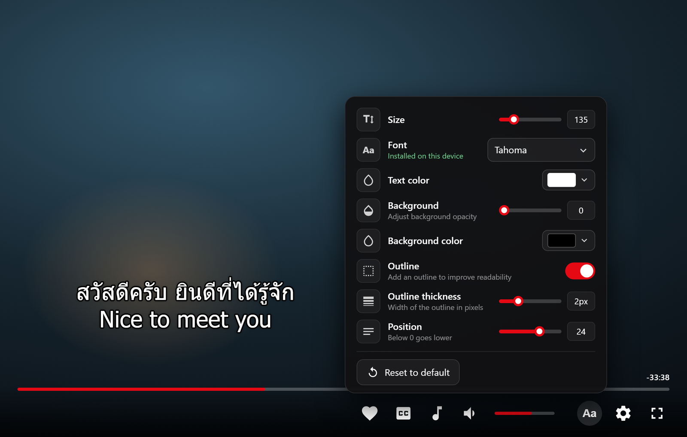

<div align="center">

# Jellyfin Live Subtitle Styler

**Style subtitles in the Jellyfin web player and desktop client while the video keeps playing.**

[](CHANGELOG.md)
[](https://jellyfin.org)



<sub>Rendered with the plugin's real script on a mock player.</sub>

</div>

## About

Adds an **Aa** button next to the gear in the player. It opens a popup where size, font, colors, outline and position change the subtitle on screen **instantly**, with no playback restart. Choices are remembered in the browser.

Works in the **web player** and in the **[Jellyfin Desktop](https://github.com/jellyfin/jellyfin-desktop) client** (mpv playback).

## Install

Requires Jellyfin **12.1+** and the [File Transformation](https://github.com/IAmParadox27/jellyfin-plugin-file-transformation) plugin. The desktop client loads the server's own web client, so nothing is installed on the computer.

1. **Dashboard > Plugins > Repositories > +**, add:
   ```
   https://raw.githubusercontent.com/baipoonnn/jellyfin-Live-Subtitle-Styler/refs/heads/main/manifest.json
   ```
2. Install **Live Subtitle Style** from the Catalog and restart Jellyfin.
3. Hard refresh the browser (Ctrl+F5) or restart the desktop client, play a video with a text subtitle, and click **Aa**.

**Updating.** Jellyfin caches the repository list. If a new version is missing from the Catalog, remove and re-add the repository, then reload the Catalog; a Jellyfin restart also clears the cache. The plugin only takes effect after a restart.

## Settings

| Setting | Range | Default |
| --- | --- | --- |
| Size | 50% to 500% | 100% |
| Font | installed font or Google Fonts family | player default |
| Text color / Background color | any | white / black |
| Background opacity | 0 to 100 | 0 |
| Outline / Outline thickness | on, 0.1 to 15 px (drag or type, steps of 0.1) | on, 1.5 px |
| Position | -10 to 40 (% from the bottom; below 0 goes lower than the edge; Jellyfin Desktop stops at -4.5) | 8 |

Only text subtitles (SRT, WebVTT) are restyled. ASS/SSA and image subtitles (PGS, DVD) keep their own styling and the panel locks while one plays. In Jellyfin Desktop, **Override ASS style** applies the style to ASS too.

In Jellyfin Desktop the style goes into a marked `# subLive` block of the manual mpv configuration. Desktop's own subtitle settings are not changed, and with Override ASS style off, ASS subtitles look exactly as those settings make them.

## Fonts

Type any font name. Only fonts your browser can really use are suggested. If a font is not installed, it is looked up on [Google Fonts](https://fonts.google.com) (a few popular ones are suggested), so it works on any device. A status line under the font says which case applies.

## Troubleshooting

- **Installed fonts are missing, or the status is red.** The browser is hiding them. In Brave set Shields > Advanced View > **Block fingerprinting** to Disabled for the site; in Firefox turn off `privacy.resistFingerprinting`. Google Fonts work either way.
- **Subtitle does not change.** It must be an SRT or WebVTT track. The panel locks for ASS and image subtitles (PGS, DVD); in Jellyfin Desktop, turn on Override ASS style to restyle ASS.
- **No Aa button.** Hard refresh, and check the plugin is Active and File Transformation is installed.
- **Desktop client shows "Browser not supported".** That page comes from another script on your server (for example a JavaScript Injector entry), not from this plugin.
- **Desktop font not applied.** The name must match an installed font family exactly.
- **Switch it off in one browser.** `localStorage.subLiveOff = '1'`, then refresh.

## Build

```
dotnet publish Jellyfin.Plugin.LiveSubtitleStyle -c Release -o out
```

Zip the DLL into `dist/` and add a version with its MD5 checksum at the top of `manifest.json`. Version history: [CHANGELOG.md](CHANGELOG.md).

## License

No license chosen yet, so all rights are reserved. Add a `LICENSE` file (for example MIT) to let others use and modify it.
