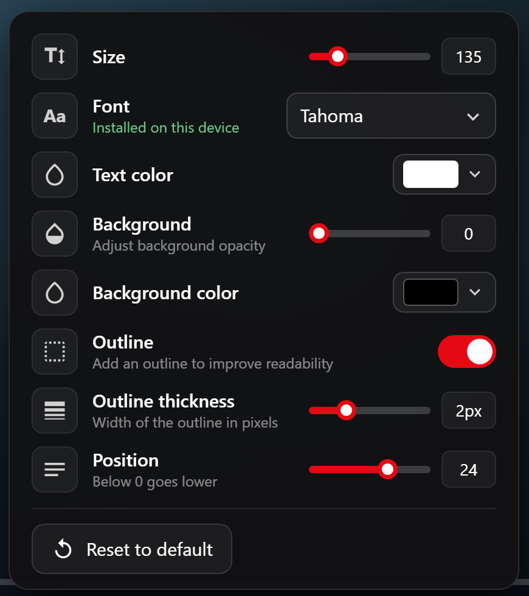

<div align="center">

# Jellyfin Live Subtitle Styler

**Style subtitles in the Jellyfin web player while the video keeps playing.**

[](CHANGELOG.md)
[](https://jellyfin.org)
[](#requirements)
[](https://github.com/baipoonnn/jellyfin-Live-Subtitle-Styler/commits/main)


<sub>Rendered with the plugin's real script on a mock player.</sub>

</div>

## Table of contents

- [About](#about)
- [Features](#features)
- [Requirements](#requirements)
- [Installation](#installation)
- [Usage](#usage)
- [Settings](#settings)
- [Fonts](#fonts)
- [Troubleshooting](#troubleshooting)
- [Compatibility](#compatibility)
- [Building from source](#building-from-source)
- [Changelog](#changelog)
- [Acknowledgements](#acknowledgements)
- [License](#license)

## About

Jellyfin's own subtitle appearance settings live on a separate page, so tuning them means leaving the video. This plugin adds an **Aa** button to the player controls, next to the gear. It opens a small popup where every change is applied to the subtitle on screen **instantly**, with no restart of playback. Your choices are remembered in the browser.

## Features

- **Live updates.** Size, font, colors, outline and position change the moment you move a control.
- **Fine control.** A **Position** control that goes below the edge of the screen, an adjustable outline thickness, sizes up to 500%, and a font box that lists only fonts your browser can use, plus web fonts from Google Fonts that work on any device.
- **Looks native.** The button is a clone of the player's gear button, so your theme styles it. The popup follows your theme's accent color.
- **Light.** One small script, one stylesheet rewrite per change, nothing running while you watch.
- **Safe.** Anything that goes wrong stays inside the script, and a one-line switch turns it off in a browser.

<p align="center">
  
</p>

## Requirements

| What | Version |
| --- | --- |
| Jellyfin server | 12.1 or later |
| [File Transformation](https://github.com/IAmParadox27/jellyfin-plugin-file-transformation) plugin | installed and active |
| Client | the Jellyfin **web** client in a browser |

The Jellyfin apps for phones and TVs do not load web plugins, so they are not affected.

## Installation

1. In Jellyfin open **Dashboard > Plugins > Repositories** and click **+**. Add:

   ```
   https://raw.githubusercontent.com/baipoonnn/jellyfin-Live-Subtitle-Styler/main/manifest.json
   ```

2. Open the **Catalog**, find **Live Subtitle Style** and install it.
3. Restart Jellyfin.
4. In your browser do a hard refresh (**Ctrl+F5**).

Every released version, with its notes, is listed under **Revision History** on the plugin's page.

## Usage

1. Play a video that has a **text** subtitle (SRT or WebVTT) turned on.
2. Click the **Aa** button next to the gear in the player controls.
3. Change anything in the popup; the subtitle updates as you go.
4. Click outside the popup or press **Esc** to close it.

**Reset to default** at the bottom puts every setting back.

## Settings

| Setting | Range | Default | Notes |
| --- | --- | --- | --- |
| Size | 50% to 500% | 100% | Some fonts render small; raise it if the text looks tiny |
| Font | any installed font or Google Fonts family | player default | A status line says where the font comes from |
| Text color | any | white | |
| Background | 0 to 100 | 0 | Opacity of the box behind the text |
| Background color | any | black | |
| Outline | on / off | on | |
| Outline thickness | 0.5 to 6 px | 1.5 px | Inactive while Outline is off |
| Position | -10 to 40 | 8 | Percent of the screen height from the bottom. Below 0 goes lower than the edge |

## Fonts

The **Font** box is a type-in field with suggestions.

- **System fonts.** Only fonts your browser can really use are suggested, so a font that cannot be shown is never offered. You can still type any font name. The check works for any script (it measures sample text in ten scripts).
- **Installed font list.** Chrome-based browsers can list every installed font after a one-time permission prompt ("Look up fonts on this device"). The exact names are then added to the suggestions.
- **Web fonts.** If a font is not installed, it is looked up on [Google Fonts](https://fonts.google.com) and loaded from there, so it works on any device. A few popular families are suggested with one click:

  | Style | Fonts |
  | --- | --- |
  | Sans-serif | Roboto, Open Sans, Lato, Montserrat, Poppins, Inter, Noto Sans |
  | Serif | Noto Serif, Merriweather |
  | Display | Oswald |

  Any other Google Fonts family works too: type its name exactly as it appears on Google Fonts, for example `Noto Sans JP` or `Sarabun`.
- **Status line.** Under the font name it shows green *Installed on this device*, *Web font from Google Fonts*, or red *Not found on this device or Google Fonts*.

### Privacy

A name typed in the Font box that is not installed (letters, digits and spaces only, after a short pause) is requested from `fonts.googleapis.com`, and the font files come from `fonts.gstatic.com`. Installed fonts and the other settings never leave your browser.

## Troubleshooting

**Installed fonts are missing from the list, or the status line is red.**
The browser is hiding installed fonts.

- **Brave:** click the lion icon on the Jellyfin page, open *Advanced View*, and set **Block fingerprinting** to *Disabled* (or *Standard*) for that site.
- **Firefox:** turn off `privacy.resistFingerprinting`.
- The font must also be installed on the device you watch from. Phones and TVs usually lack Windows fonts.
- Web fonts from Google Fonts work in every browser, so type or pick one of those instead.

**The subtitle does not change.**
It must be a text subtitle (SRT or WebVTT). ASS/SSA and PGS tracks carry their own styling and are not restyled.

**The Aa button is missing.**
Do a hard refresh (Ctrl+F5). Check that the plugin shows as **Active** and that File Transformation is installed. A theme or plugin that renames the player's gear button (`btnVideoOsdSettings`) can also hide it; please open an issue with the theme name.

**Turn the script off in one browser.**
Run `localStorage.subLiveOff = '1'` in the browser console and refresh. Run `localStorage.removeItem('subLiveOff')` to turn it back on.

## Compatibility

- Works with the stock web player and with the [WebGPU Player](https://github.com/alchemyyy/jellyfin-plugin-webgpu-player) plugin.
- Developed and tested with the Netflin theme on Jellyfin 12.2. Other themes should work because the button copies the player's own, but they are untested.

## Building from source

Requires the .NET 10 SDK.

```
dotnet publish Jellyfin.Plugin.LiveSubtitleStyle -c Release -o out
```

To publish a version: zip `Jellyfin.Plugin.LiveSubtitleStyle.dll`, put the zip in `dist/`, and add an entry with its MD5 checksum at the top of `manifest.json`. Jellyfin rejects a zip whose MD5 differs from the manifest's `checksum`, and it caches the manifest for a few minutes, so a new version can take a little while to show in the catalog.

How it works: the plugin registers an `index.html` callback with File Transformation and appends one script to the page. The callback only edits markup and returns anything else unchanged, because the pattern also matches the player's JavaScript chunk `playback-video-index-html.<hash>.chunk.js`.

## Changelog

See [CHANGELOG.md](CHANGELOG.md).

## Acknowledgements

- [File Transformation](https://github.com/IAmParadox27/jellyfin-plugin-file-transformation) by IAmParadox27, used to add the script to the web client.
- [Jellyfin](https://jellyfin.org) and its [plugin template](https://github.com/jellyfin/jellyfin-plugin-template).

## License

No license has been chosen yet, so all rights are reserved by default. Add a `LICENSE` file (for example MIT) to allow others to use and modify the code.
